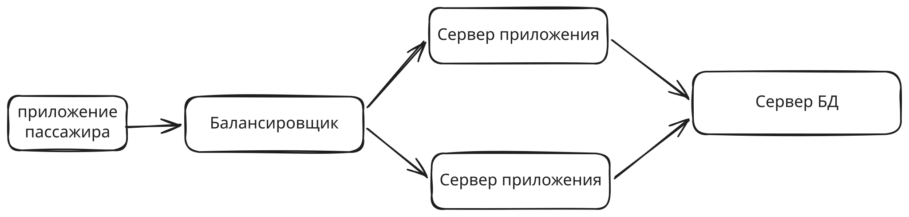
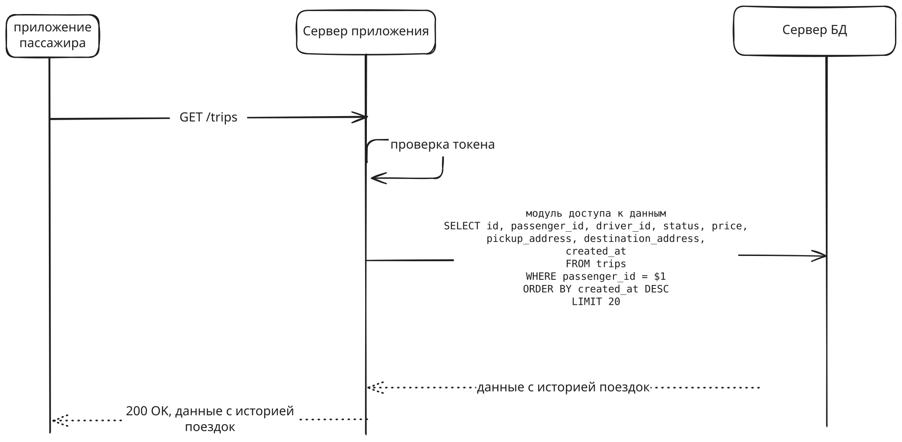

## Граница системы

Опишите назначение сервиса, пользователей, внешних участников и границу работы.

Сервис заказа такси. Пользователи сервиса: клиенты которые ищут такси, водители. 
Граница работы - создание поездки, чтение состояния и просмотр истории.

## Требования

Посчитайте среднюю и пиковую частоту создания поездки, чтения состояния и просмотра истории. Запишите цель p95 истории и объем поездок за год.

### Исходные данные
Создание поездки:	200 тысяч поездок в сутки	
Чтение состояния:	Один запрос каждые 5 секунд в течение поездки длиной 15 минут	
Просмотр истории:	60 тысяч открытий в сутки

### Расчет
Средняя частота создания поездки: 200000/24/60/60 = ~2.3rps
Пиковое значение при коэффициенте x4: ~9rps

Средняя частота чтения состояния: 15 x (60/5) = 180req. 200000 x 180/24/60/60 = ~420 rps
Пиковое значение при коэффициенте x4: ~1700

Средняя частота просмотра истории: 60000/24/60/60 = ~0.7rps
Пиковое значение при коэффициенте x1.5: ~1.5rps

### Цель p95 истории
<50ms на 2.000.000 поездок. Допустимая доля ошибок - 0.1%

### Объем поездок за год при среднем потоке

1 поездка = 1 КБ. За сутки: 1 КБ x 200.000 = 200 МБ. За год: 200 МБ x 365 = 73 ГБ

## Операции

Сведите три операции в таблицу со сценарием и пиковой частотой.

| Сценарий | Пиковая частота |
| --- | --- |
| Создание поездки | 9 RPS |
| Чтение состояния | 1700 RPS |
| Просмотр истории | 2 RPS |

## Окружение

Нарисуйте в Excalidraw схему с пассажиром, балансировщиком, двумя экземплярами приложения и базой данных. Сохраните исходник и картинку в _design/architecture_ и вставьте сюда картинку.



## Компоненты

Нарисуйте в Excalidraw путь запроса истории через HTTP-обработчик, модуль доступа к данным и PostgreSQL. Сохраните исходник и картинку туда же и вставьте сюда картинку.



## Модель данных

Опишите связь пассажира с поездками и поля запроса истории.

Пассажиры хранятся в таблице passengers, поездки в таблице trips. Связь осуществляется через passengers.id (PK) = trips.passenger_id (FK).

У каждой поездки ровно один пассажир. У пассажира может еще не быть заказов или уже быть несколько сотен поездок. Связь называют «один ко многим», и внешний ключ passenger_id хранят на стороне множества, в trips.

Запрос истории пассажира:
```
SELECT 
  id, passenger_id, driver_id, status, price,
  pickup_address, destination_address, created_at
FROM trips
WHERE passenger_id = :passenger_id
ORDER BY created_at DESC
LIMIT 20
```

Фильтруется по :passenger_id, чтобы каждый авторизованный пользователь видел только свою историю. ORDER BY created_at DESC нужен для сортировки по времени создания заказа.

Поля запроса истории:
| Поле | Тип | Значение |
| :----- | :----- | :----- |
| id | BIGINT, PK | Числовой идентификатор поездки |
| passenger_id | BIGINT NOT NULL | ID пассажира  |
| driver_id | BIGINT | ID водителя (если назначен) |
| status |  VARCHAR(32) NOT NULL | статус поездки |
| price | NUMERIC(12, 2) NOT NULL | Цена в рублях с двумя знаками после запятой |
| pickup_address |VARCHAR(500) NOT NULL | начальный адрес |
| destination_address | VARCHAR(500) NOT NULL | конечный адрес |
| created_at | TIMESTAMPTZ NOT NULL | время создания записи |

## Итог

### Требования 

| Требование | Значение |
| :----- | :----- |
| p(95) истории | <50мс |
| доля ошибок | <0.1% |

### Базовый результат

| Требование | Значение |
| :----- | :----- |
| p(95) истории | ~49мс |
| доля ошибок | 0% |

### Решение

По базовым замерам мы почти достигли требования p(95)<50ms. Необходимо исследовать запрос на выборку истории.
Решение и варианты записаны в design/adr/010-history-index.md

Повторный результат замеров после внесения изменений

| Требование | Значение |
| :----- | :----- |
| p(95) истории | ~4мс |
| доля ошибок | 0% |

Вывод «p95 истории < 50 мс» подтвержден при условиях:
  - ~2 млн поездок в trips (около 10 дней потока), около 200 поездок на пассажира, история запрашивается для пассажиров 1-1000;
  - нагрузка стенда 5/20/5 rps (создание/чтение/история), прогон 30 с;
  - 2 экземпляра приложения по 0.5 CPU и 512 МБ, одна PostgreSQL, данные в основном в кэше (shared hit).

По истории вывод с запасом: ее пиковая частота (1.5 rps) ниже проверенной (5 rps), а план с индексом почти не зависит от размера таблицы. Поэтому он должен сохраниться и при годовом объеме (~73 млн строк). Для чтения состояния вывод не проверен: на стенде было 20 rps при цели ~1700.

### Следующий ожидаемый предел

Пропускная способность чтения состояния поездки (GET /trips/:id). На пике это ~1700 rps, в 85 раз больше проверенного. 
Взял его, потому что там самое большое расхождение с тестируемой нагрузкой.

| Операция | Проверили | Нужно на пике | Во сколько раз не дотянули |
| :----- | :----- | :----- | :----- |
| Создание | 5 rps | 9 rps | ×1.8 |
| История | 5 rps | 1.5 rps | уже с запасом |
| Чтение состояния | 20 rps | 1700 rps | ×85 |

### Следующий опыт

**Вопрос:** какую частоту чтения состояния поездки выдерживает стенд при p95 < 50 мс и доле ошибок ≤ 0.1%?

**Изменяемый фактор:** только `stand.readRate` в `load/profile.json`, по ступеням 100 / 200 / 400 / 800 rps. Создание и история остаются 5/5 rps, данные и лимиты контейнеров не меняются.

**Критерий прохождения:** ступень пройдена, если p95 чтения < 50 мс, `http_req_failed` ≤ 0.1% и `dropped_iterations` = 0. Последняя пройденная ступень - предел стенда по чтению состояния.
